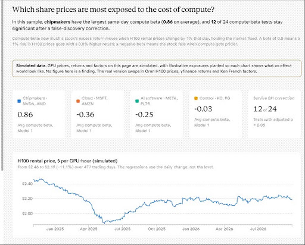
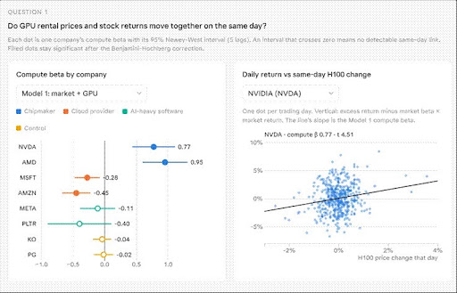
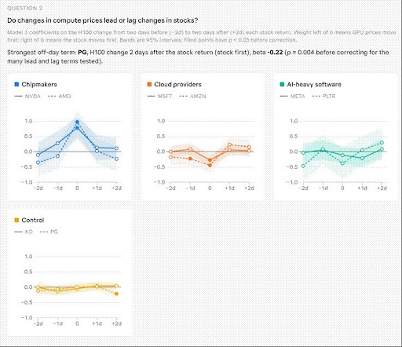
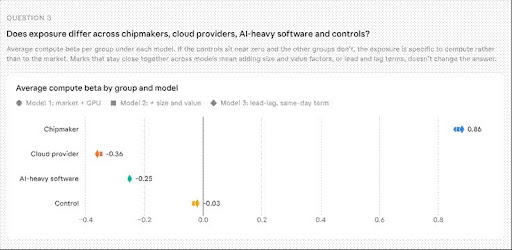
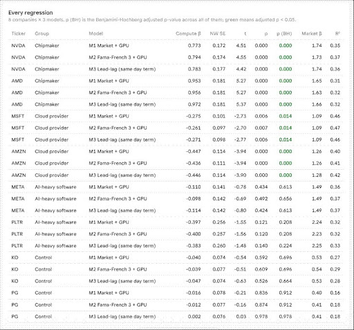

# Which Stocks Are Exposed to GPU Prices?

## 1. The Question

**Research Question:** Which companies' share prices are most exposed to the cost of compute?

We want to answer three questions:

1. Do GPU rental prices and stock returns move together on the same day?
2. Do changes in compute prices lead or lag changes in stocks?
3. Does exposure differ across chipmakers, cloud providers, AI-heavy software, and firms with no compute exposure?

### Who Will Pay?

Ornn and its customers (anyone hedging compute costs), a portfolio manager sizing AI exposure, or a CFO whose margins depend on GPUs.

## 2. The Data

### Unit of Observation

One row represents one company on one trading day. Each row includes the ticker, date, stock's daily return, risk-free rate, stock's excess return, market excess return, and daily change in GPU rental prices.

### Example Rows

| Ticker | Group | Date | ret | rf | ret_rf | mkt_rf | dgpu |
|---|---|---|---:|---:|---:|---:|---:|
| NVDA | Chipmaker | 2026-09-30 | 0.0051 | 0.0001 | 0.0050 | -0.0026 | 0.0008 |
| META | AI-heavy software | 2026-09-30 | -0.0184 | 0.0001 | -0.0185 | -0.0026 | 0.0008 |
| KO | Control | 2026-09-30 | -0.0088 | 0.0001 | -0.0089 | -0.0026 | 0.0008 |

### Sample Period and Conditions

Our sample period is from November 4, 2024, to September 30, 2026, covering 477 trading days.

Our initial version (V0) uses eight companies, with two companies in each group:

| Group | Companies |
|---|---|
| Chipmakers | NVIDIA (NVDA), AMD (AMD) |
| Cloud Providers | Microsoft (MSFT), Amazon (AMZN) |
| AI-Heavy Software | Meta (META), Palantir (PLTR) |
| Controls | Coca-Cola (KO), Procter & Gamble (PG) |

The control group includes companies with little to no direct GPU exposure.

### Must-Have vs. Nice-to-Have Variables

**Must-have daily variables:**
- GPU rental prices (H100)
- Stock prices
- Risk-free rate
- Market return

**Nice-to-have variables:**
- More companies (closer to 30)
- Other GPU types beyond H100
- Time of day when Ornn sets its prices

### Raw Data Sources

| Data | Source | File Location |
|---|---|---|
| GPU rental prices | Ornn, provided through our professor | `data/raw/ornn/` |
| Stock prices | Yahoo Finance (`yfinance`) | `data/raw/stocks/prices.csv` |
| Market and factor returns | Kenneth French Data Library | `data/raw/ken_french/ff3_daily.csv` |

Ornn's GPU rental price data is private and is not uploaded to the public repository. Our current pipeline uses simulated GPU prices to test the code.

## 3. Methodology

We want to examine whether GPU rental prices and stock returns move together, particularly for companies involved in AI computing. First, we began pulling stock data using Yahoo Finance, along with market data from the Kenneth French Data Library. For GPU rental prices, our pipeline is designed to use Ornn's H100 data, but we are currently using simulated prices to test the code. From there, we calculated daily stock returns and changes in GPU rental prices, rather than comparing the prices themselves. We then matched the datasets by trading date, with each row representing one company on one trading day.

After preparing the data, we used Ordinary Least Squares (OLS) regression to calculate a compute beta for each company. This measures how a company's stock returns relate to changes in GPU rental prices while accounting for market returns. For example, NVIDIA and AMD manufacture GPUs, while Microsoft and Amazon use computing infrastructure to support their cloud services. An increase in GPU rental prices could therefore affect these companies differently. We also included market returns in the regression because NVIDIA's stock could increase even if GPU rental prices remained unchanged. Additionally, we used Newey-West standard errors with five lags to account for possible correlation in daily regression errors.

To examine the relationship further, we ran three regressions for each company. The first looks at whether GPU price changes and stock returns move together on the same day while accounting for market returns. We then added the Fama-French size and value factors in the second regression to see whether our results changed. Finally, the third regression examines GPU price changes up to two trading days before and after stock returns. For example, if H100 rental prices increased on Monday but NVIDIA's stock moved on Tuesday, this model would help us examine whether there was a delayed relationship.

Once we completed the regressions, we compared compute betas across four groups: chipmakers (NVDA, AMD), cloud providers (MSFT, AMZN), AI-heavy software companies (META, PLTR), and control companies (KO, PG). We then organized the results into tables and graphs for our Streamlit dashboard. Our current sample includes eight companies and 477 trading days, from November 4, 2024, to September 30, 2026. As we continue the project, we plan to expand the sample to around 30 companies and replace the simulated GPU prices with actual Ornn data.

## 4. Threats and Checks

One concern with our project is look-ahead bias, which happens when information is used before it was actually available. For example, if Ornn records its H100 rental prices at 6:00 p.m., comparing those prices with NVIDIA's stock return ending at 4:00 p.m. would create a problem because the GPU price was recorded after the market closed. To avoid this, we plan to confirm when Ornn records its prices and adjust how we match the trading dates if needed.

Another concern is finding significant results simply by chance. Since we are running three regressions for eight companies, we currently have 24 regressions. Interestingly, even though our simulated GPU prices were generated independently of stock returns, META still had a statistically significant result in one regression. This is important because it shows that a significant result does not always mean there is a real relationship. We have kept a record of the models tested and plan to adjust for multiple testing once we begin using the actual Ornn data.

We also considered whether our control group was appropriate. Currently, we use Coca-Cola and Procter & Gamble because they have little direct exposure to GPU rental prices. However, these companies operate in consumer goods, while NVIDIA and AMD are involved in technology and semiconductors. This difference could affect our comparison, since their stock prices may react differently to market conditions. As we expand our sample, we plan to include additional control companies and check whether the results change.

Additionally, GPU rental prices and technology stocks could react to the same events. For example, if Microsoft announced a major increase in AI infrastructure spending, demand for GPU rentals could rise while investors also become more interested in AI-related stocks. In this situation, both GPU prices and stock returns could increase without one directly causing the other. We included market returns and Fama-French factors in our regressions to account for some of these effects, and we plan to test an additional technology-market control.

Finally, we need to make sure our data is matched correctly. Our code matches GPU prices with stock trading dates and carries forward the most recent GPU price when an observation is missing. For example, if H100 rental prices change over the weekend, the change would appear in Monday's observation. However, if Ornn does not update its prices for several days, carrying forward the old price could make it appear that GPU rental prices have remained unchanged. We plan to check for these stale prices before using the real data.

To check our calculations, our pipeline already tests for duplicate company-date observations and independently recalculates selected stock returns and regression coefficients. We also keep Ornn's actual rental prices out of our public GitHub repository because the data is private. For now, our simulated data allows us to test the pipeline, but we cannot determine which stocks are actually exposed to GPU costs until we use the real prices.

## 5. Dashboard Mockup

The following screenshots show our proposed dashboard, including compute betas, lead-lag relationships, group comparisons, and regression results.

These images are illustrative mockups rather than findings from actual Ornn rental-price data.

